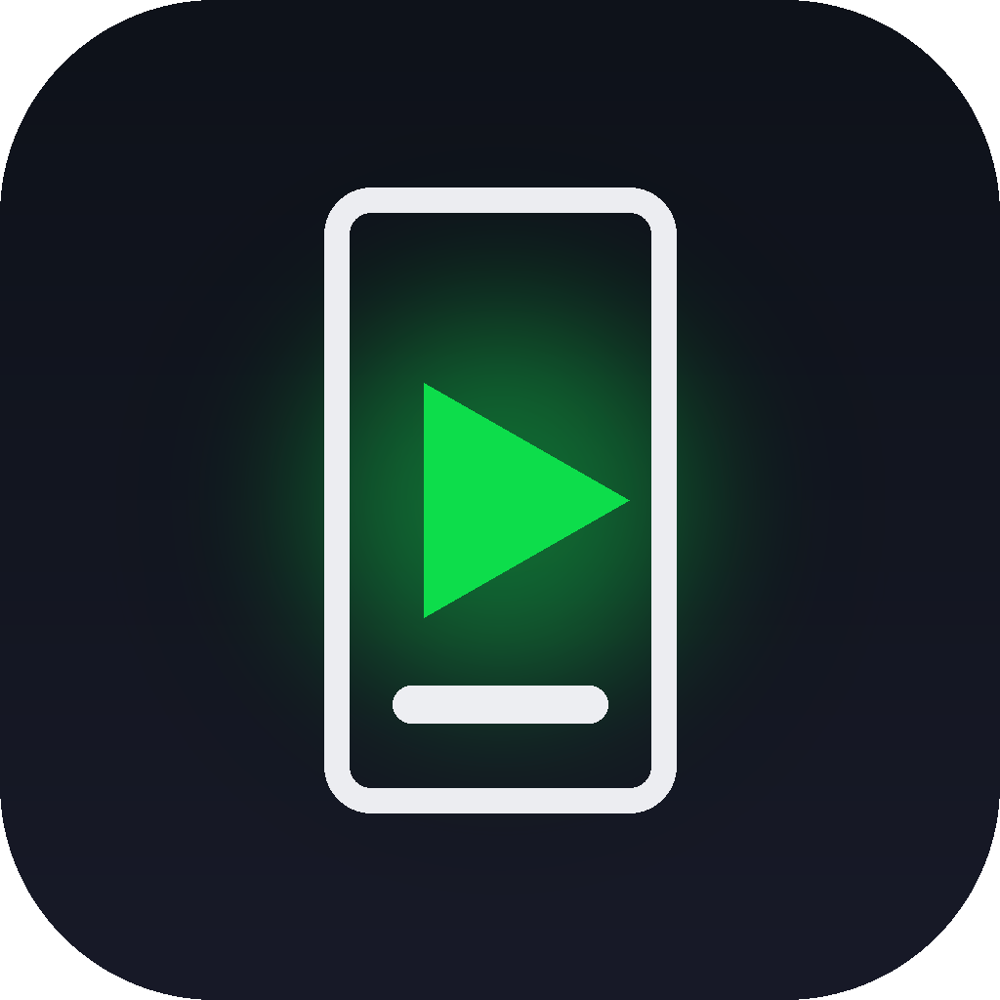
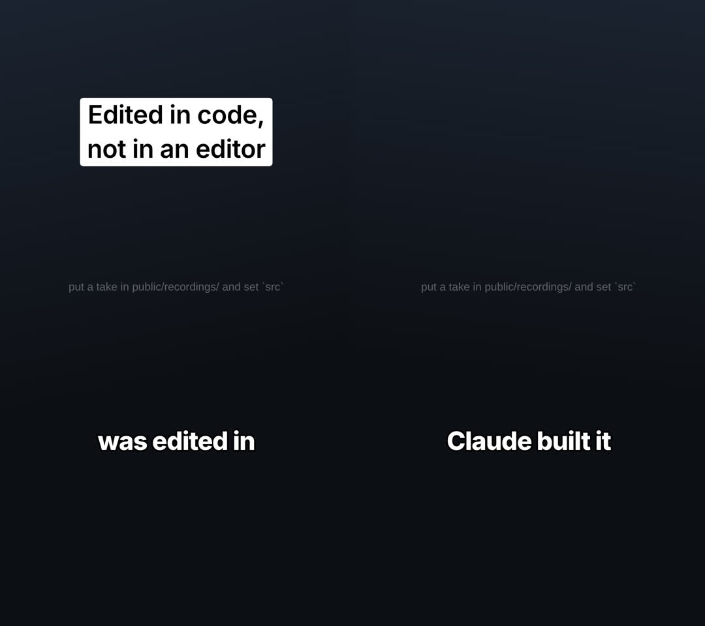

<h1 align="center">Video Studio</h1>

<b>Edit reels by talking to Claude.</b> 
A free plugin for the Claude app and Claude Code. No editor, no timeline.

 
<a href="https://github.com/bharatk101/claude-video-studio/releases/latest">Latest release</a> · <a href="docs/prompts.md">Prompts</a> · <a href="docs/guide.md">Guide</a> · <a href="CHANGELOG.md">Changelog</a> · <a href="#roadmap">Roadmap</a>

---

You film a take (or a few clips) on your phone and tell Claude what you want: *"cut the pauses, add captions and a
hook."* Claude builds the edit in code and renders the video.

It started as a one-paragraph setup prompt for Claude. Video Studio is that prompt made reliable for anyone: the
same setup every time, on any computer, with every render checked before you see it.

## How it works

**1. Install it** (once, about 30 seconds). In claude.ai or the Claude desktop app, open
**[Customize > Plugins](https://claude.ai/customize/plugins)**, click **Add > Add marketplace**, enter
`bharatk101/claude-video-studio`, and add **Video Studio**. (Code execution needs to be on: **Settings >
Capabilities > Create and edit files**.)

**2. Set up a project.** Link a folder to the chat (the **+** menu, **Add folder**) and say:

> Set up a reel project in ~/Movies/reels

Claude creates the project and gives you **one line** to paste, which installs and checks everything, ending in
`ok` or `FAIL` for each step:

| | Say | Paste |
|---|---|---|
| macOS | Set up a reel project in `~/Movies/reels` | `cd ~/Movies/reels && bash run.sh setup` (Terminal) |
| Windows | Set up a reel project in `C:\Users\you\Videos\reels` | `cd ~/Videos/reels && bash run.sh setup` ([Git Bash](https://git-scm.com/download/win)) |
| Linux | Set up a reel project in `~/Videos/reels` | `cd ~/Videos/reels && bash run.sh setup` |
| Your own folder | Set up a reel project in `~/Dropbox/Shorts` (any path, any drive) | the line Claude gives you |

**3. Add your footage.** Drop your clips into `public/recordings/`, or a folder of their own inside it.

**4. Ask for the edit.** Pick the clips by name, or point at a folder:

> Join intro.MOV, take3.MOV and outro.mp4 in that order, cut the pauses and the ums, add captions and a hook
> that says "how I edit without an editor"

> Join everything in public/recordings/coffee-reel in the order I filmed it, cut the pauses and add captions

The finished video lands in `out/`. Notes like *"captions are a bit late at 0:12"* or *"make the hook shorter"*
work the same way. **[More prompts to copy](docs/prompts.md)**: picking clips, ordering, zooms, music, and notes
after the first cut.

 
The starter reel project: an Instagram-style text hook and captions timed to the transcript.

## What it can do

- **Several clips into one video:** any phone format, turned upright, sized for Reels, matched in volume, joined.
- **Jump cuts:** pauses and filler words removed, never mid-word.
- **Captions that land on the exact frame** you say each word, placed around your face, never on your chin.
- **Hooks, layouts and motion graphics** in your own brand style, plus screen recordings with smooth zooms.
- **Music and sound effects**, checked in the final render.

The [guide](docs/guide.md) has the full list, the commands Claude runs, where each feature works, and how to set
things up by hand.

## Other ways to install

- **Claude Code:** `/plugin marketplace add bharatk101/claude-video-studio`, then
  `/plugin install video-studio@video-studio`. (Added it in the Claude app already? It syncs to Claude Code by
  itself.)
- **As a file:** download `video-studio.zip` from the
  [latest release](https://github.com/bharatk101/claude-video-studio/releases/latest), then in the Claude app use
  **Customize > Plugins > Add > Upload plugin**.

## Roadmap

What's done is in the [changelog](CHANGELOG.md). Next, roughly in order (contributions welcome: open an issue to
pick one up):

- [ ] Find a handheld mic automatically, so captions sit on it without measuring
- [ ] A sample clip in the repo, to try the whole reel workflow in a minute
- [ ] Auto-reframe 16:9 footage to 9:16 by following the speaker's face
- [ ] Captions in other languages and scripts (Hindi, Kannada, and more)
- [ ] Export the edit to Premiere / DaVinci Resolve for hand touch-ups
- [ ] Thumbnails and covers from the same brand sheet
- [ ] Publish straight to Instagram, TikTok and YouTube with a caption

## Contributing

Run `python3 tests/run_tests.py` before a pull request; CI runs it on macOS, Linux and Windows. How the repo fits
together is in the [guide](docs/guide.md#how-its-built).

## Credits

Built by Bharat over many real edits for an Instagram channel, on [Remotion](https://www.remotion.dev),
[ffmpeg](https://ffmpeg.org), [whisper.cpp](https://github.com/ggml-org/whisper.cpp),
[faster-whisper](https://github.com/SYSTRAN/faster-whisper) and [OpenCV](https://opencv.org).

## License

MIT. See [LICENSE](LICENSE).
